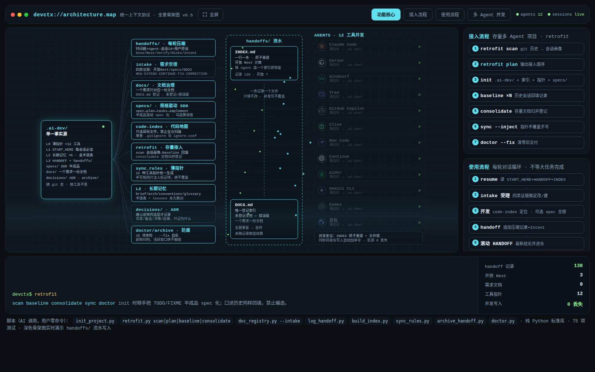
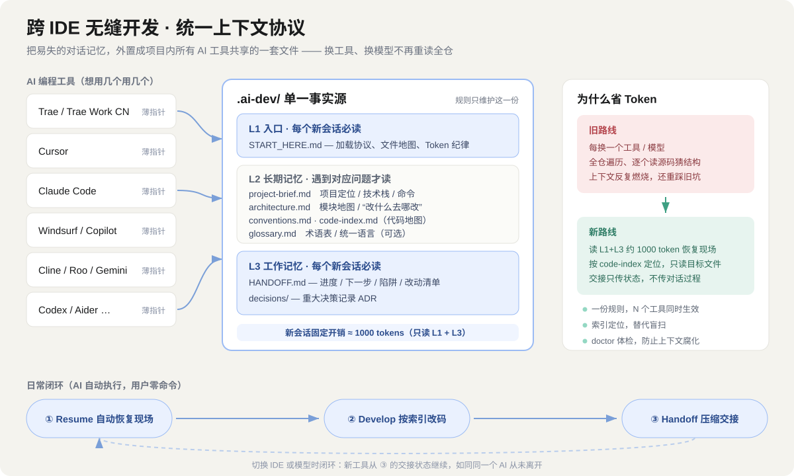

# devctx

[](CHANGELOG.md)
[](LICENSE)
[](scripts/)
[](scripts/)

> 让**同一个项目**在任意多个 AI 编程工具 / IDE / 模型 / 时间 / 人之间无缝接续开发：换工具不丢上下文、不重读全仓、不重复烧 token、不重复踩旧坑。
> 内置 **Spec Kit（SDD）**：init 时自动把项目现状 spec 化，说"用 spec 做 XXX"自动跑完整规格驱动开发流程。
>
> 最新版本 **v0.7.0**（每轮对话压缩流水 / 多 Agent 协作 / intake 需求受理 / 存量项目接入 retrofit / 收工清理 cleanup / 深度清理按会话圈定残留）· 许可证 MIT · 纯 Python 标准库，跨 Windows / macOS / Linux

**[▶ 打开动态骨架导图（交互版，一屏看完全部机制）](https://af49fc77d61398fc8.app.workbuddy.host)**

<a href="https://af49fc77d61398fc8.app.workbuddy.host"></a>

*↑ 动态骨架导图（点击打开交互版；clone 本仓库后也可直接双击 `docs/devctx-map.html` 离线查看，单文件零依赖）*



切换工具之所以贵，是因为 AI 对项目的认知只存在于**易失的对话历史**里——每换一个 IDE、一个模型、隔几周回来、或换个人接手，它都要重新遍历代码库、重新猜结构、重新踩一遍旧坑。

本技能把项目认知**外置成项目内的一套文件 `.ai-dev/`**：规则只维护一份，各工具用十几行的"薄指针"指过来；任何新会话只需读入口与交接文件即可恢复现场，其余按需加载。

## 解决什么问题

| 浪费来源 | 典型表现 | 本技能对策 |
|---|---|---|
| 全仓遍历 | 每个新工具都 ls/find、逐个打开源码猜结构 | `code-index.md` 代码地图定位，只读目标文件 |
| 规则重复 | 每个工具各维护一套规则，改一次要同步 N 份 | 单一事实源 + 薄指针，规则只写一遍 |
| 长对话重发 | 换模型要带上全部历史，越滚越大 | 每轮对话结束压缩成结构化 HANDOFF，只传状态不传过程 |
| 探索弯路 | 新工具不知道之前试过什么不行 | HANDOFF 陷阱区 + `lessons.md` 永久教训，避免重蹈覆辙 |
| 文档泛滥 | 每个需求新建一份文档，越堆越乱，Agent 分不清哪份算数 | 一个需求一份文档 + `DOCS.md` 登记索引，未登记即错误 |
| 特性漂移 | 用户插话/追加被当成新需求重做，做出来不是用户要的 | 动手前 intake 四类证据裁定改还是建，结论写进 `Intent` 留痕 |
| 残留文件 | AI 干活留下的缓存/临时/测试残留堆满项目，污染索引、误导新 Agent | 收工时 `cleanup.py` 按明文规格扫描列出，询问后删除，`.git`/`.ai-dev`/`dist` 等永不触碰；会话特别长时 `--deep --session` 读该会话全部记录、只圈定它产生的残留，不误伤其他会话 |

## 它不只是"跨 IDE"——7 个真实使用场景

很多人第一次看到这个项目以为只解决"Cursor 换 Claude Code"，其实它解决的是更底层的问题：**让 AI 对项目的认知持久化、可携带、不随对话窗口消失**。

| 场景 | 发生了什么 | 本技能怎么救 |
|---|---|---|
| **① 跨工具切换** | 今天用 Cursor，明天用 Trae，后天换 Windsurf | 各工具 10 行指针指向 `.ai-dev/`，新会话自动读 START_HERE + HANDOFF |
| **② 跨模型切换** | 同一个 IDE 里从豆包换到 Claude，或升级模型 | 对话历史带不过去，但 `.ai-dev/` 在仓库里，新模型直接读 |
| **③ 跨时间冬眠** | 项目放了三周/三月，回来不知道做到哪了 | HANDOFF 记录"下一步动作"，LESSONS 记录"别再这么干"，读两个文件就续上 |
| **④ 跨人交接** | 同事 A 用 Cursor，同事 B 用 Claude Code，你来接手 | `.ai-dev/` 提交进 git，clone 下来就是完整的项目记忆，不用开会口述 |
| **⑤ 接手遗产代码** | 到新公司/新项目，面对没人讲得清的老代码 | init 自动建 code-index + architecture + glossary + 自动 spec 化项目现状，AI 半小时建立完整心智模型 |
| **⑥ 团队 AI 规范统一** | 团队成员各用各的工具，规则各写各的 | 规则只在 `.ai-dev/` 维护一份，所有工具共享；`doctor --check` 进 CI 防漂移 |
| **⑦ 接手多 Agent 遗留项目** | 项目已被好几个 AI 会话开发过，代码是攒的、文档散落、半成品看不见 | `retrofit.py` 把 git 历史切成历史会话画像回填成记录，存量文档按"一个需求一份文档"归并登记 |

> 哪怕你只用一个 IDE、一个模型，这个项目也有用——**单人长期项目的"冬眠后苏醒"** 和 **`lessons.md` 沉淀"这个项目永远不能这么干"** 本身就值回票价。

## 动态骨架导图：一屏看完全部机制

文字协议读三遍，不如看图一遍。导图把整个 devctx 画成一棵**深色终端风格的骨架流程树**，带绘制动画：

- **12 个 AI 工具**（真实品牌图标）沿 AGENT TREE 分布，各自薄指针指向同一棵上下文树；
- **四层上下文**（L0 指针 → L1 入口 → L2 长期记忆 → L3 工作记忆）为主线；
- **十个功能模块**一张卡一个：handoffs 压缩流水、intake 需求受理、docs 文档治理、specs·规格驱动 SDD、code-index 代码地图、retrofit 存量接入、sync_rules 工具指针、L2 长期记忆（术语表 + lessons）、decisions·ADR、doctor 体检；
- 交互：点击模块跳到对应协议章节；移动端横屏观看，内置全屏按钮。

**[▶ 打开交互版导图](https://af49fc77d61398fc8.app.workbuddy.host)** ｜ 离线版：`docs/devctx-map.html`（仓库内单文件，零外部依赖，浏览器直接打开）

## 核心模型：四层上下文

| 层 | 文件 | 读取时机 |
|---|---|---|
| L0 工具指针 | `AGENTS.md`、`CLAUDE.md`、`.cursor/rules/…`、`.trae/rules/…` 等 | 工具启动时自动读，仅十几行，指向 `.ai-dev/` |
| L1 入口 | `.ai-dev/START_HERE.md` | **每个新会话必读** |
| L2 长期记忆 | `project-brief / architecture / conventions / glossary / lessons / code-index` | 遇到对应问题才按需读 |
| L3 工作记忆 | `HANDOFF.md`（当前状态总览）+ `handoffs/`（每轮对话压缩流水）+ `docs/`（需求文档，一个需求一份）+ `decisions/` | **每个新会话必读**，每轮对话结束自动追加 |

新会话固定开销只有 L1 + L3（目标控制在约 1k token 量级），L2 与源码按需加载。相比让 AI 重扫整个仓库，省一个数量级以上。

**L2 里的 `lessons.md`** 是项目的"永久教训本"：
- HANDOFF 陷阱区记**本次临时坑**（易失，随 handoff 压缩）
- 某个坑**重复出现第二次**，提升到 lessons.md（持久，跨阶段生效）
- 新 agent 动手前先查 lessons.md——"这个项目永远不能这么干"——避免重蹈覆辙

## 每轮对话压缩规范：治"上下文一长就失忆"

失忆的根因是压缩没有落到文件、也没有格式。devctx 把压缩定义为**每轮对话结束必须追加一条独立记录**到 `.ai-dev/handoffs/`：

```text
1. 时间戳        ISO 8601 带时区，例 2026-10-12T16:20:33+08:00
2. Agent-会话Id  哪个 Agent、哪个会话产生的，例 claude-code / a1b2c3d4
3. 用户原话      用户这一轮的完整原始需求，一字不删、不改写、不概括
4. 本轮压缩      Done / Next / Verify / Risks 任意组合（可缺省，至少一段）
```

| 段 | 写什么 |
|---|---|
| `Done` | 已经做了什么，具体到可验证结果（改了哪个文件、跑到什么状态） |
| `Next` | 下一步做什么，按依赖排序，`- [ ]` 形式，完成即勾选 |
| `Verify` | 要跑什么测试 / 命令证明 Done 真的成立 |
| `Risks` | 有什么坑：试过且走不通的路、容易踩的雷、要避开的事项 |

**为什么不全写进单个 `HANDOFF.md`**：单文件既会无限膨胀（token 预算失控），又会因并行 Agent 互相覆盖而丢记录。
`handoffs/` 一条记录一个文件（`<时间戳>-<Agent>-<会话Id>.md`，只增不改），
`INDEX.md` 一行一条汇总（含 Agent / 会话 / **开放 Next 计数**）——换模型、换会话、换 Agent 后读一个索引就能定位，
需要完整上下文时再按文件名读那一条。`HANDOFF.md` 仍是**当前状态总览**，每轮把最新结论并进去。

**多 Agent 并发安全**：记录各自独立成文件，写方永不覆盖他人；`INDEX.md` 用"临时文件 + 原子替换"重建并加文件锁。
多个 Agent / 多个会话同时改一个项目，靠三条约定协作：

- 各写各的文件，先读 `INDEX.md` 的「开放 Next」列再动手，避免撞车；
- 接手别人的活，先读那条记录，再在自己记录里写明"接手自 \<文件名\>"；
- `HANDOFF.md` 是唯一共享黑板，冲突时以代码现状为准，并把冲突写进自己那条的 `Risks`。

> 上下文长到失忆时才想起交接，已经晚了——每轮都写，成本才是一条记录的几十行。

## 文档治理 + 需求受理：治"文档泛滥与特性漂移"

前两个问题（失忆、规则重复）治好后，第三个问题浮出来：**每个新需求都新建一份文档**，`docs/` 很快堆成小山，下一个 Agent 分不清哪份算数；更糟的是用户说到一半插话、输出完又追加要求，Agent 没察觉这是在改同一个需求，**另起一份文档重新做**——做出来的功能漂移，甚至根本不是用户要的。

devctx 用两道闸门防住：

**第一道：一个需求只对应一份文档。** 全部需求文档只放 `.ai-dev/docs/`，`DOCS.md` 是唯一登记索引。新建任何文档前必须先查 `DOCS.md`；能并进现有文档的，禁止新建。用户分几次说、中途插话、输出后追加、发现理解错了要更正——**统统是修改现有文档**，不是新建。严禁按对话轮次组织文档（`登录-第2次.md` 是反模式），只按主题组织（`auth-sms-login.md`）。

**第二道：动手前先做需求受理（intake）。** 用户说话是随意的——功能可能已做完、做一半，或正在被改表述。Agent 不凭措辞猜，先跑 `doc_registry.py --intake`，拿四类证据裁定：

| 证据 | 说明 |
|---|---|
| `handoffs/` 里未闭环的 `Next` | 最可能的"续做 / 更正"信号 |
| `specs/*/tasks.md` 未完成任务 | Spec Kit 流程里的半成品 |
| `docs/DOCS.md` 现有文档 | 需求的长期事实源 |
| 代码地图 | 兜底对照 |

裁定优先级：**active 文档 > 未闭环记录 > specs > 全新主题**。文档是需求的长期事实源，记录只是过程流水——有主文档就必须落到文档上，否则"改需求"会被当成"新任务"重新建一份文档，那就是特性漂移的起点。判定结论（`NEW` / `EXTEND` / `FIX` / `CONTINUE` / `CORRECTION`）写进本轮 handoff 记录的 `### Intent` 小节，下一个 Agent 读得到，不会重新立案。

```text
用户："短信验证码登录先别用手机号了，改用邮箱"     ← 做到一半插话
intake → EXTEND → docs/auth-sms-login.md           ← 改同一份，禁止新建
```

`doctor` 把未登记文档（绕过 `DOCS.md` 直接落盘）列为**错误级**问题，`--check` 可直接进 CI。

## 存量多 Agent 项目接入：会话回填 + 文档归并

前面讲的都是"从零接入"。真实里更多是另一种：**项目已经被好几个 Agent/会话开发过**——
代码是攒的、文档散落各处、半成品看不见。直接 init 只会得到一套空壳，新 Agent 照样不知道
谁在什么约束下写了什么。`retrofit.py` 把历史变成协议认的证据：

| 命令 | 做什么 |
|---|---|
| `scan` | 按"作者 × 时间窗"把 git 历史切成**历史会话画像**（间隔超 14 天自动分窗，例 `legacy-bob`），并列存量文档清单与 TODO/FIXME 半成品信号 |
| `probe` | 探测本机各工具的本地会话存储（Claude Code `~/.claude/projects/`、Aider 项目内历史、Codex、Continue、Cline/Roo 任务库、Cursor/Windsurf/Trae 工作区存储），**只列 Id/路径/数量，不读消息正文**；`plan` 会自动带上探测结果，把"用户有真实会话 Id 吗"变成有证据的选项 |
| `plan` | 把证据填进接入 SOP，输出这个项目的具体顺序（init → spec 化 → 会话回填 → 文档归并 → 指针 → 体检），并附 probe 发现的本地会话存储 |
| `baseline --session S --topic T` | 为每个历史会话写一条**基线重建记录**（agent 固定 `retrofit`）——这就是"压缩各会话 Id"：INDEX 从此列出 `legacy-bob 欠着验证码网关没接完` |
| `consolidate [--apply]` | 对每份存量 .md 给"并入哪份需求文档 / 独立成篇"建议（**匹配看正文**）；AI 合并后 `--apply` 登记 |

```text
git 历史：Alice 三月/九月各一批、Bob 六月一批
   → scan：legacy-alice-1 / legacy-alice-2 / legacy-bob 三个画像
   → baseline ×3：三条合规记录进 handoffs/，开放 Next 进 INDEX
   → consolidate：docs/api.md → 并入 docs/auth-sms-login.md（相关度 21.5）
```

两条纪律：**历史口述同样回填，记不得就写"历史口述：…"，禁止编造**；
**存量文档合并不复制两份**，原处留路径引用。半成品信号（TODO/FIXME）就是接入后第一批「开放 Next」。

## 安装（3 步，零配置）

你只需要"拿到**整个文件夹**、放进 AI 助手的技能目录"，不需要配置任何脚本，也不需要单独安装 Python 包。

### 第 1 步：获取完整文件夹（二选一）

- **方式 A（最简单）**：本仓库页面右上角绿色按钮 **Code → Download ZIP**，解压得到 `devctx/` 文件夹。
- **方式 B（会用 git）**：

  ```bash
  git clone https://github.com/JacksenHu/devctx.git
  ```

> 必须是**整个文件夹**（同时含 `SKILL.md`、`scripts/`、`assets/`、`references/`）。不能只拿 `SKILL.md` 一个文件——`scripts/` 里的 .py 是 AI 要调用的工具，缺一不可。

### 第 2 步：放进 AI 助手的"技能目录"

| 助手环境 | 放置位置（举例） |
|---|---|
| 豆包桌面端 | `.user_skills/devctx/` |
| 其他支持"技能 / 规则 / skills"的 AI 编程助手 | 其文档指定的 skills / rules 目录下，保持同名文件夹 |

放好后**新开会话**（或重启对话）让助手识别到技能。

### 第 3 步：在你的项目里对 AI 说一句话

> "给这个项目接入统一上下文。"

之后建 `.ai-dev/`、扫描代码填写项目文档、生成代码地图、铺工具指针、自动 spec 化项目现状、体检等动作链都由 AI 自动完成，你不需要手动运行任何脚本。

### 你到底需要操心什么？（几乎没有）

| 事项 | 是否需要你做 |
|---|---|
| 安装 / 配置 `scripts/` 里的 .py | **不用**，随文件夹自带，由 AI 自动调用 |
| `pip install` 第三方依赖 | **不用**，全部是 Python 标准库 |
| 自己敲命令或脚本路径 | **不用**，全程对 AI 说话即可 |
| 电脑里安装 Python | **可选**；没装时 AI 会改用文件操作等价完成，不会要求你安装 |
| 指定用哪些 IDE | **不用**，脚本自动识别你正在用的工具 |
| 装 specify CLI 才能用 spec | **不用**，AI 直接写 markdown 文件，CLI 是可选增强 |

## 日常工作流（AI 自动执行）

- **init（每个项目一次）**：初始化 `.ai-dev/`（含 `handoffs/`、`docs/` 与其模板）、自动检测技术栈（Node/Python/Go/Rust + monorepo 子包 + .env 变量）、首份代码索引、工具指针，并由 AI 据实起草 L2 文档（project-brief / architecture / conventions / glossary；lessons 初始可空）。**自动 spec 化项目现状**：扫 TODO/FIXME/半成品，已完成的写 spec.md，未完成的完整跑 spec → plan → tasks。
- **resume（新会话自动）**：读 START_HERE + HANDOFF + `handoffs/INDEX.md`，沿"下一步"继续；动手前先查 lessons.md。
- **intake（动手前自动，第零原则）**：用户提出需求后，先跑 `doc_registry.py --intake` 拿四类证据裁定改现有文档还是新建；文档一律进 `.ai-dev/docs/` 并登记进 `DOCS.md`，一个需求只对应一份文档。
- **handoff（每轮对话结束自动）**：往 `handoffs/` 追加一条压缩记录（时间戳 + Agent-会话Id + 用户原话 + Done/Next/Verify/Risks + Intent 受理结论），并把最新结论滚动进 HANDOFF.md；增删文件则更新代码索引；重大决策补 ADR；HANDOFF 陷阱区某坑重复第二次则提升到 lessons.md。**每轮都写，不等大任务完成**——这是多会话并发、换 agent 不丢上下文的关键。追加成功后 AI 会在回复末尾附 `记忆已储存（<记录文件名>）` 让用户可核对；想找回某个会话当时干了什么用 `log_handoff.py --find <会话Id或Agent名>`，想查哪里没了记忆用 `--gaps`。
- **retrofit（存量多 Agent 项目接入）**：`scan` 把 git 历史切成历史会话画像、清点存量文档与半成品信号；`baseline` 为每个历史会话回填一条合规记录（"压缩各会话 Id"）；`consolidate` 给存量文档归并建议并登记；最后 doctor 清零。
- **archive（记录超量自动）**：HANDOFF 超 120 行搬历史区，`handoffs/` 超 200 条搬最旧的进 `archive/handoffs/`，活跃窗口不动。
- **cleanup（收工清理，用户说"收工/清理"时自动）**：按明文规格扫描 AI 干活留下的缓存 / 临时 / 测试残留文件（`__pycache__` / `.pytest_cache` / `*.tmp` / `*.pyc` / `.coverage` 等，谨慎类 `node_modules/.cache` / `.next/cache` / >1MB 日志默认只列），把清单展示给用户、**用户同意后**才删除；`.git` / `.ai-dev` / `specs` / `node_modules` / `dist` / `build` 永不触碰；`--context N` 从最近 N 轮 handoff 记录提取"这些缓存是不是这轮测试产生的"线索。
- **cleanup 深度清理（用户说"深度清理"、会话特别长时自动）**：`--deep --session <会话Id>` 读该会话**全部** handoff 记录，按整个会话上下文圈定它产生的残留（完整路径在记录里出现、或文件名/目录名被显式提及才命中；提过的后缀只提示不圈定，绝不误伤其他会话的缓存）；圈定 → 展示清单 → **用户同意后**删除，安全边界与普通 cleanup 相同。
- **doctor（体检）**：一键发现空模板文档、过时索引、超长交接、指针漂移、**本机在用工具缺专属指针**（probe 探测会话存储：本地在用的工具没有指针，它的新会话读不到 `.ai-dev` 上下文，`--fix` 定点补齐）、`.ai-dev` 被 git 误忽略、schema 版本过期、**对话流水腐化**（索引漂移 / 记录缺原话或压缩节 / 记录数超限 / HANDOFF 落后于流水）、**未登记文档 / 文档缺主题或来源 / 主题重复**、**ADR 编号撞号或文件名不合规**（两份 ADR 顶同一个编号 = 两份"权威"，选型失据）等腐化，`--fix` 自动修复；CI 可用 `--check` 拦截。

## 已覆盖的 AI 工具（12 种，可扩展）

AGENTS.md 通用兜底（Codex / Amp / Zed）、Claude Code、Cursor（新版 .mdc 与旧版 .cursorrules）、Windsurf、Gemini CLI、GitHub Copilot、**Trae / Trae Work CN**、Cline、Roo Code、Continue、Aider。新增工具只需在 `scripts/_common.py` 的 `TOOL_SPECS` 加一条映射。

## 目录结构

```text
devctx/
├── SKILL.md                     # 唯一入口：AI 的操作手册（触发判断、自动动作链、降级路径）
├── scripts/                     # AI 调用的工具，用户无需运行
│   ├── init_project.py          # 初始化 .ai-dev（含 handoffs/ + docs/）+ 技术栈检测 + 首份索引 + 工具指针
│   ├── log_handoff.py           # 每轮对话压缩记录：追加记录 + 重建 INDEX + --find/--gaps 反寻（多 Agent 并发安全）
│   ├── retrofit.py              # 存量项目接入：历史会话画像 + 基线回填 + 存量文档归并登记
│   ├── doc_registry.py          # 文档登记索引 DOCS.md + 需求受理 intake（防文档泛滥与特性漂移）
│   ├── build_index.py           # 生成代码地图（尊重 .gitignore 与 ignore.conf）
│   ├── sync_rules.py            # 生成/校验/注入各工具薄指针（幂等）
│   ├── archive_handoff.py       # 安全归档超长 HANDOFF 历史与超量对话记录
│   ├── cleanup.py               # 收工清理：按规格扫描缓存/临时/测试残留，询问后删除（默认 dry-run）；--deep 按会话上下文圈定 |
│   ├── doctor.py                # 健康体检 + --fix 自动修复（含 handoffs / docs 腐化 / session-stores 检查）
│   └── _common.py               # 工具映射表、项目根探测、忽略匹配、Agent/会话识别
├── assets/templates/            # 初始化时复制进项目的自包含模板
│   ├── START_HERE.md            # L1 入口
│   ├── HANDOFF.md               # L3 工作记忆（当前状态总览）
│   ├── handoff-entry.md         # 每轮对话压缩记录模板（复制为 handoffs/0000-template.md）
│   ├── doc-template.md          # 需求文档模板（复制为 docs/0000-template.md，一个需求一份）
│   ├── DOCS.md                  # 文档登记索引模板（复制为 docs/DOCS.md）
│   ├── project-brief.md         # L2：项目定位/运行命令
│   ├── architecture.md          # L2：模块分区/改什么去哪改
│   ├── conventions.md           # L2：编码/命名/提交规范
│   ├── glossary.md              # L2：业务术语表（可选）
│   ├── lessons.md               # L2：永久教训（可选）
│   └── decisions/0000-template.md
├── references/                  # 分层协议详解 & 各工具集成机制（AI 按需读）
└── docs/
    ├── context-architecture.svg # 四层上下文静态图解
    ├── devctx-map.html          # 动态骨架导图（单文件零依赖，交互版）
    └── devctx-map.png           # 导图缩略图（永久链接：https://af49fc77d61398fc8.app.workbuddy.host）
```

使用者只与 `SKILL.md`（间接，通过对话触发）打交道；`scripts/`、`assets/`、`references/` 都由 AI 自行取用。

## 脚本命令（供 AI 调用，用户无需手敲）

```bash
python scripts/init_project.py <项目根> [--all] [--force]
python scripts/log_handoff.py <项目根> --user-file user.txt --body-file body.md \
    [--agent claude-code --session a1b2c3d4] [--model sonnet] [--intent "EXTEND → docs/auth.md"]
python scripts/log_handoff.py <项目根> --list | --tail 3 [--agent cursor] | --template | --rebuild-index
python scripts/log_handoff.py <项目根> --find a1b2c3d4   # 找回某会话当时干了什么（按条目文件名读全文）
python scripts/log_handoff.py <项目根> --gaps           # 时间线缺口：哪里没了记忆（间隔大不等于漏写）
python scripts/retrofit.py <项目根> scan | plan | probe           # 存量项目：证据清点 / 接入顺序 / 本机会话存储探测
python scripts/retrofit.py <项目根> baseline --session legacy-bob --topic auth-sms-login \
    --user-file u.txt --done "..." --next "- [ ] ..." --risks "..."   # 历史会话基线回填
python scripts/retrofit.py <项目根> consolidate [--apply]          # 存量文档归并建议 / 登记
python scripts/doc_registry.py <项目根> --intake --user-file user.txt     # 需求受理：改现有文档还是新建
python scripts/doc_registry.py <项目根> --find 登录 | --list | --rebuild | --check | --init
python scripts/doc_registry.py <项目根> --add docs/auth-sms-login.md --topic "短信验证码登录" \
    --source "NEW 2026-10-12" [--status active] | --archive docs/old.md
python scripts/build_index.py  <项目根> [--max-lines 1200] [--max-depth 4]
python scripts/sync_rules.py   <项目根> [--all] [--inject] [--check]
python scripts/archive_handoff.py <项目根> [--max-lines 120] [--max-entries 200] [--entries-only]
python scripts/cleanup.py <项目根> [--apply] [--yes] [--include-caution] [--context N] [--list-specs]
                # 收工清理：按规格列出 AI 干活的缓存/临时/测试残留（默认只列不删）
python scripts/cleanup.py <项目根> --deep [--session <会话Id>] [--apply] [--yes]
                # 深度清理：读该会话全部 handoff 记录圈定其产生的残留（默认只列不删；--session 省略时列出会话）
python scripts/doctor.py       <项目根> [--fix]   # 0 健康 / 1 警告 / 2 错误
```

全部脚本纯 Python 标准库、跨平台、UTF-8、幂等；手写规则文件默认绝不覆盖。
`log_handoff.py` 的记录只增不改，`INDEX.md` 原子重建并加锁，多 Agent 并发写安全。
**每轮追加成功后，AI 会在给用户的回复末尾附一句 `记忆已储存（<记录文件名>）`**——
用户看不见 `.ai-dev/` 内部，这句确认是唯一闭环；写入失败必须如实报告，禁止假装储存。

## 设计原则

1. **用户零命令、零设置**：脚本只由 AI 调用；没有 Python 时 AI 用文件工具等价落地。
2. **单一事实源**：一份规则只存一处，其余位置写路径引用，杜绝 N 份漂移。
3. **薄指针**：工具私有文件只放路标，规则全部回归 `.ai-dev/`。
4. **最小固定开销**：新会话只读 L1+L3，按需才读 L2 与源码。
5. **自包含**：生成进项目的文件不依赖本技能存在，没装技能的 IDE 也能照协议运转。
6. **可防腐**：doctor 体检 + HANDOFF 归档 + lessons 沉淀，让上下文长期可靠。
7. **统一语言**：业务术语只在 `glossary.md` 定义一次，所有文档和代码命名引用它，跨工具说同一种话、省 token。
8. **失败分层**：临时坑写 HANDOFF（易失），重复踩第二次提升到 lessons.md（持久），AI 不重复交学费。
9. **每轮压缩**：每轮对话结束都写 HANDOFF，不等大任务完成，支持多会话并发和换 agent。
10. **一个需求一份文档**：文档按主题组织、登记进 `DOCS.md`；用户插话/追加/更正都是改现有文档，动手前先做需求受理，严禁按对话轮次新建。

## 与 speckit / Spec Kit 规格驱动开发（SDD）联动

devctx **内置** [github/spec-kit](https://github.com/github/spec-kit)（GitHub 官方 spec 驱动开发工具）工作流。你只装 devctx 一个 skill，说"用 spec 做 XXX"就能自动跑完整 SDD 流程，不需要单独装 spec-kit skill。

speckit 管"这次新需求怎么做"（spec → plan → tasks → implement），devctx 管"项目长期记忆怎么跨工具保持"（`.ai-dev/`），两者通过文件系统对接。

### 怎么用（2 步）

**第 1 步：在项目里对 AI 说一句话**

> "用 spec 做个登录功能"

devctx 自动完成：

| 阶段 | AI 做什么 | 产物 |
|---|---|---|
| spec | 提炼短名，写用户场景（P1/P2/P3 + Given/When/Then）、功能需求、成功指标 | `specs/001-login/spec.md` |
| plan | 写技术方案、架构决策、实施步骤、验证方式 | `specs/001-login/plan.md` |
| tasks | 拆任务清单：依赖、并行标记 [P]、TDD 验收标准 | `specs/001-login/tasks.md` |
| implement | 按 tasks.md 依赖顺序执行，每完成一个勾 `[x]` | 代码 + 勾选 tasks.md |

> **不需要装 specify CLI**——AI 直接写 markdown 文件。如果你以后想用官方 CLI 的模板和脚本，可以跑 `uv tool install specify-cli` 增强，不是必需。

**第 2 步：收工自动同步**

handoff 时 AI 自动读 `tasks.md` 勾选状态，把进度写进 HANDOFF：
> 进行中的 spec：`specs/001-login/tasks.md` 第 3/7 条（正在做"JWT 刷新"）

换工具/新会话后，新 AI 读 HANDOFF 就知道在 spec 流程哪一步，不用重读整个 spec。

### 文件分工

| 目录 | 谁维护 | 存什么 |
|---|---|---|
| `.ai-dev/` | devctx | 项目长期记忆（brief / architecture / conventions / HANDOFF） |
| `specs/<名>/` | speckit | 本次需求的 spec / plan / tasks |
| `.specify/` | specify CLI | 模板、脚本、项目原则（constitution） |

**不互相复制内容**，只写路径引用。

> 第三方打包（dceoy/speckit-agent-skills、skills.sh）默认不需要——devctx 已经把工作流写进 SKILL.md 了。

## 与其他工程流程 skill 的关系

本技能只解决"跨 IDE / 模型 / 时间 / 人的上下文与记忆"这一件事，不替代工程流程类 skill。两者**互补共存**：例如 [mattpocock/skills](https://github.com/mattpocock/skills)（需求追问、TDD、调试、架构改进、issue 流程等）管"怎么把活做对"，本技能管"换工具/模型/人/时间时现场不丢、不重复烧 token"。可以同时安装，互不冲突。

## 适合 / 不适合

- 适合：
  - 一个项目要在多个 AI IDE/模型间切换；
  - 单人长期项目隔几周回来不知道做到哪；
  - 团队不同成员用不同 AI 工具，想统一规范和交接；
  - 接手没人讲得清的遗产代码；
  - 希望显著降低重复读码的 token 成本；
  - 多会话并发开发同一项目，需要每轮压缩上下文。
- 不替代：版本控制（仍建议 git）、正式架构评审工具、实时协同编辑。

## License

[MIT](LICENSE)
